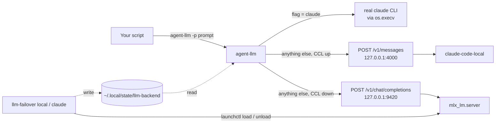

# How it works

There are three moving parts and one file.

## The flag file

`~/.local/state/llm-backend` (or `LLM_BACKEND_FLAG`) holds one word. `llm-failover` writes it. `agent-llm` reads it on every call. There is no daemon and no cache, so a flip affects the very next call.

## agent-llm

A single Python file using only the standard library (`json`, `os`, `shutil`, `sys`, `urllib.request`, `pathlib`).

1. Resolves settings from environment variables.
2. Reads the flag. Missing file means `claude`.
3. **Claude mode:** checks that `CLAUDE_BIN` exists, then calls `os.execv`. The Python process is replaced by `claude` with the same arguments. Nothing about the call is changed or wrapped.
4. **Local mode:** scans arguments for `-p`, takes the next argument as the prompt (or reads stdin), and picks the server: `LOCAL_LLM_URL` if set; else claude-code-local at `http://127.0.0.1:$CCL_PORT/v1/messages` if its `/health` answers within 1.5 seconds; else `http://127.0.0.1:$LLM_PORT/v1/chat/completions`. A `/v1/messages` URL gets an Anthropic Messages request (`x-api-key`, `anthropic-version`, 300 second timeout) and the reply's text blocks are printed. Anything else gets a chat-completions request with `temperature: 0.3`, `max_tokens: LOCAL_LLM_MAX_TOKENS` and a 120 second timeout, and `message.content` (or `message.reasoning` if content is empty) is printed. It exits 0, or prints `agent-llm local error: ...` and exits 1.

## llm-failover

A Bash script run with `set -e`.

- **`local`** writes the flag first. If claude-code-local's `/health` answers on `CCL_PORT`, it stops there (agent-llm will use that server). Otherwise, if `curl` cannot reach `http://127.0.0.1:$LLM_PORT/v1/models` within 2 seconds, it checks the plist exists, runs `launchctl load` and `launchctl kickstart gui/<uid>/<label>`, then polls once a second for up to 180 seconds, printing a dot every 5 seconds. On success it runs the notify hook.
- **`claude`** writes the flag. If `local` loaded the LaunchAgent (it leaves a marker file next to the flag) and `launchctl list` still shows the label, it runs `launchctl unload` so the model's memory is freed. A server it did not load is left alone. Then it runs the notify hook.
- **`status`** prints the flag and which server is serving: claude-code-local, mlx-lm, or down.

## The mlx-lm server

The LaunchAgent runs `python -m mlx_lm.server --model <id> --host 127.0.0.1 --port 9420` from your venv. `mlx_lm.server` is part of [mlx-lm](https://github.com/ml-explore/mlx-examples/tree/main/llms/mlx_lm) from Apple's ml-explore team, built on [MLX](https://github.com/ml-explore/mlx); this repo only supplies the launchd template. `RunAtLoad` and `KeepAlive` are off, so the server exists only between `llm-failover local` and `llm-failover claude`.

Because `agent-llm` speaks the OpenAI chat-completions format, any server with a compatible `/v1/chat/completions` endpoint can be used by pointing `LOCAL_LLM_URL` at it. `llm-failover`'s load/unload logic is specific to launchd, and its health check expects `/v1/models` on `127.0.0.1`. <!-- TODO-VERIFY: only mlx_lm.server is referenced in the repo; other servers are untested. -->

## Lazy loading

Most of the time you are on Claude and the local model uses no memory. The cost is a cold start after each flip to local. The README puts this at 30 to 90 seconds depending on the machine and whether the weights are in the OS file cache, and gives about 10 tokens per second for a 30B-class model on M-series chips. <!-- TODO-VERIFY: cold start and tok/s figures are from README.md, not from a benchmark in the repo. -->

For instant failover, set `RunAtLoad` to `true` in the plist. The server then starts at login and holds its memory. `llm-failover claude` leaves it running, because it did not load it.

## What local mode does not do

From the code, not a roadmap:

- **No automatic failover.** Nothing watches for usage limits or outages. You or your own script run `llm-failover local`.
- **Only the prompt is forwarded.** `--output-format json`, `--model`, `--allowedTools`, system prompts, tools, MCP and every other flag are ignored. Output is plain text.
- **One-shot only.** One user message, no conversation history, no streaming.
- **`-p` is the only prompt flag recognized.** A long-form `--print` or a positional prompt without `-p` is ignored, and stdin is read instead.
- **macOS only for the switch.** `agent-llm` is portable; `llm-failover` needs `launchctl`.

Local 7B to 30B models are also weaker than Claude at repo-specific knowledge, subtle tone, long-context reasoning across many files, and agentic coding. The project is meant to keep agents alive while Claude is unavailable, then switch back.
